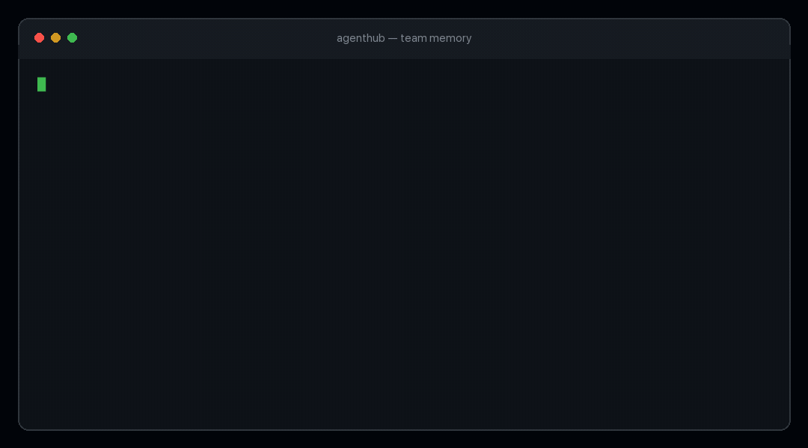

# agent-session-hub

**Team memory for AI coding agents — self-hosted, event-first, no session files centralised.**

[中文说明](README.md) · License: [Apache-2.0](LICENSE)

`agent-session-hub` is a small self-hosted service that answers questions like:

- *Who already touched the rate limiter, and why was it moved from 100 to 500?*
- *A teammate is on leave — what was she in the middle of, what did she decide, what's left?*
- *Which machine did this work happen on?*
- *Who approved that risky file write, and what exactly changed?*

Code stays in git. Session files stay in `~/.claude` / `~/.codex` / `~/.workbuddy` on each
person's own machine. What travels is a thin stream of **events**: who, in which repo, asked what,
which files were touched, how the turn ended. Those events land in Postgres, and any agent
(Claude Code, Codex, Cursor, WorkBuddy, DSH, your own plugin) can query them over MCP.

Optional, explicit, second layer: the **original session archive** (the raw JSONL, gzipped) so a
session can actually be resumed on a different machine with `claude --resume`. That is opt-in and
never on by default.



*(Demo content is sample data. The GIF is generated by `docs/demo/make_demo_gif.py` and is
reproducible.)*

---

## Why event-first

Most "share your AI sessions" tools move whole transcripts around. That gets you the text but
loses the things that matter operationally:

| | Cookie-cutter session sync | agent-session-hub |
|---|---|---|
| What is centralised | Whole transcripts | One-line event summaries + optional archive |
| Source code | Sometimes bundled | **Never** — always git |
| Retrieval | Full-text over walls of transcript | Structured: project / owner / machine / tool / file / time |
| Handover | "Read my 900-line chat" | Generated report: history, hot files, decisions, open threads |
| Resume on another machine | Usually no | Yes, via the opt-in archive layer + path rewriting |
| Approval / audit trail | No | Yes — orchestration events carry who approved what |

The design bet: **the reusable asset is not the transcript, it is the decision plus its
provenance.** A 60-word turn summary with an owner, a repo, a file list and a timestamp is
searchable, quotable and cheap. A 4 MB JSONL is none of those things at team scale.

## Architecture

Two layers, deliberately separated.

```
┌─────────────── member machines ───────────────┐
│                                                │
│  Claude Code ──┐                               │
│  Codex ────────┼── hooks ──┐                   │
│  WorkBuddy ────┤           │  HTTPS + token    │
│  DSH / custom ─┘           │                   │
│                            ▼                   │
│  ~/.claude/… (kept local)      ┌───────────────────────────┐
│  git repos     (kept in git)   │  hub server (FastAPI)     │
│                                │  ├ events   (Postgres)    │
│  agenthub CLI ─────────────────┤  ├ projects / handover    │
│   pull / wb-pull / wb-diff     │  ├ transcripts (opt-in)   │
│                                │  ├ /m  mobile (read-only) │
└────────────────────────────────┤  └ /v1/agent-prompt        │
                                 └────────────┬──────────────┘
                                              │ stdio MCP
                              ┌───────────────┴───────────────┐
                              │ any agent: search_team_memory │
                              │ get_project_handover …        │
                              └───────────────────────────────┘
```

- **Event layer** (default): one summary line per turn, tool names, file paths, skill/MCP calls,
  token totals. Searchable via Postgres `pg_trgm`. Cheap. Cannot resume a session.
- **Archive layer** (opt-in): the raw transcript, byte-for-byte, gzipped in Postgres, with
  revisions, diffs, revert and a 24 h cross-machine claim lock. This is what makes
  `--resume` work on another machine.

Stack: Python 3.11, FastAPI, asyncpg, PostgreSQL 16 (`pg_trgm`), Docker Compose.
No Redis, no vector DB, no message queue, no frontend build step. The CLI and hooks are
standard-library Python on purpose — a hook must never be able to break someone's editor.

## Quick start (server)

```bash
git clone https://github.com/AAAlenwow/agent-session-hub.git && cd agent-session-hub
cp .env.example .env && chmod 600 .env        # set POSTGRES_PASSWORD and ADMIN_TOKEN
docker compose up -d --build
curl -s http://127.0.0.1:8421/health          # {"ok":true}
```

Create one token per teammate (only the hash is stored):

```bash
curl -s -X POST "http://127.0.0.1:8421/v1/admin/users?name=zhangsan" \
     -H "Authorization: Bearer $ADMIN_TOKEN"
# → {"id":2,"name":"zhangsan","token":"…"}
```

`ADMIN_TOKEN` is a full-power credential: it can create users, reassign any project, and revert
any session. Keep it out of the hands of normal members.

Put it behind TLS (Caddy example):

```
mem.example.com {
    reverse_proxy 127.0.0.1:8421
    tls internal
}
```

## Member onboarding (~3 minutes)

> The install directory `~/.agent-hub` and the `AGENT_HUB_` env prefix keep the project's
> former name (`agent-hub`). They are already baked into deployed hook configs, so renaming
> them would break existing installs. The directory itself is arbitrary — swap the absolute
> paths below and it works the same.

```bash
mkdir -p ~/.agent-hub
cp hooks/cc_hook.py hooks/codex_notify.py mcp/mcp_query.py \
   client/agenthub.py client/wb.py ~/.agent-hub/
alias agenthub='python3 ~/.agent-hub/agenthub.py'

export AGENT_HUB_URL=https://mem.example.com
export AGENT_HUB_TOKEN=<your personal token>
```

### Claude Code / GLM / MiniMax (all speak the CC hook protocol)

Append to `~/.claude/settings.json` — same command for `UserPromptSubmit`, `PostToolUse`, `Stop`:

```json
{
  "hooks": {
    "Stop": [
      {"hooks": [{"type": "command",
        "command": "AGENT_HUB_URL=https://mem.example.com AGENT_HUB_TOKEN=<token> AGENT_HUB_AGENT=claude-code python3 ~/.agent-hub/cc_hook.py"}]}
    ]
  }
}
```

### Codex

`~/.codex/config.toml`:

```toml
notify = ["python3", "/Users/you/.agent-hub/codex_notify.py"]
```

### Anything else (DSH, dsh-go, your own plugin)

`hooks/generic_report.py` is a stable contract — stdin JSON or flags, two env vars, always
`exit 0` on failure so it can never break the caller:

```bash
echo '{"session":{"ext_id":"dsh-abc","agent":"dsh","project":"billing"},
       "events":[{"kind":"turn_end","summary":"switch retry to exponential backoff"}]}' \
  | python3 ~/.agent-hub/generic_report.py
```

### Attach the MCP server

```bash
pip install "mcp[cli]"
claude mcp add team-memory --env AGENT_HUB_URL=https://mem.example.com \
    --env AGENT_HUB_TOKEN=<token> -- python3 ~/.agent-hub/mcp_query.py
```

Then just ask, in any agent: *"who changed the rate limiter and why?"*

## MCP tools

| Tool | What it does |
|---|---|
| `search_team_memory(q, limit)` | Full-text search across every teammate's turn summaries, titles, file paths |
| `recent_team_sessions(limit)` | Latest activity across the team |
| `get_team_session(session_id)` | Full event timeline of one session |
| `list_team_machines()` | Which machines report, how many sessions, last active |
| `list_team_projects()` | Projects and their current owners |
| `get_project_handover(project)` | Generated handover report (see below) |
| `share_team_memory(...)` | Explicitly publish a conclusion (used in `curated` / `strict` mode) |
| `team_memory_instructions()` | Fetch this deployment's live sharing policy |
| `list_active_leases()` | Who is currently executing which session (call before taking over) |
| `acquire_session_lease(session_id)` | Claim execution rights; returns a generation token |
| `release_session_lease(session_key, generation)` | Hand execution rights back |

## Carrying on from another machine: session leases (v0.6)

The archive layer answers "can I resume on a different machine". It does not answer
"can two people resume at the same time" — and the more common failure in a real team is
that **a piece of work gets welded to one machine**. The person goes on leave, changes laptops,
or the machine dies, and whoever takes over has to ask "so what were you thinking?".

v0.6 makes execution rights an explicit server-side state instead of first-connect-wins:

```bash
agenthub lease status                                # who is running what, right now
agenthub lease acquire 42                            # I want to continue (409 tells you who holds it)
agenthub lease transfer claude-code:abc --to build-01:7788   # hand off to a runner in the cloud
agenthub lease release claude-code:abc --generation 5        # done, give it back
```

- **One executor per session.** Others get a 409 that names the holder, the machine, the time
  left and the generation — not a bare conflict.
- **`generation` is a fencing token.** It increments on every hand-off; renewals and writes
  carrying a stale generation are rejected. That is what stops two contexts from silently
  overwriting each other, not just a mutex.
- **Renew, don't hard-expire.** Long-running work is no longer seized at the 24-hour mark.
- **Three MCP tools** let the agent decide for itself: `list_active_leases`,
  `acquire_session_lease`, `release_session_lease`.
- **Visible on the phone**: `/m` shows `▶ running · alice · 38m left` on the card and timeline.

This is complementary to scheduling hubs such as
[agent-autoloop](https://github.com/KKKKhazix/agent-autoloop): **they make work run; this layer
makes work survive a hand-off.** A scheduler abstracts work into an event stream, but the work
still lands in one process on one machine. Keeping execution rights on the server is what makes
"another machine / another person / a runner in the cloud" possible at all. The full five-step
flow for picking up the same session on an on-demand runner is in
[docs/SESSION_LEASE.md](docs/SESSION_LEASE.md).

## Handover: the reason this exists

A teammate goes on leave. The new owner runs one call:

```bash
curl -H "Authorization: Bearer <token>" \
     https://mem.example.com/v1/projects/api-gateway/handover
```

The report contains: the owner timeline, the previous owner's sessions, **hot files by
frequency**, skills and MCP servers actually used, conclusions that were shared, and recent
questions. In-agent it is `get_project_handover("api-gateway")`.

Ownership changes are append-only — `assign` releases the incumbent automatically, so the
"who owned this when" history survives personnel churn.

## Chain-of-thought sharing without shipping transcripts

At the end of every turn the `Stop` hook reads the tail of the local transcript, finds the last
assistant message that has real prose (progress / fix / conclusion / next step), clips it
(default 800 chars, `AGENT_HUB_TURN_SUMMARY_CHARS`) and reports it as a `turn_end` summary.
The server redacts secrets before insert.

Effect: a colleague on a fresh machine, with the archive layer **off**, can still
`search_team_memory("christmas campaign")` and get the actual conclusion text from three weeks ago.

## Machine origin

Every session records the machine it came from (`hostname`, or `AGENT_HUB_MACHINE` for a
human-readable alias such as `"Alice's MacBook"` / `"hk-build-01"`).

- `GET /v1/machines` — per machine: session count, distinct people, last active, projects
- `agenthub list` — extra `machine` column
- `list_team_machines()` — the agent can answer "where did this work happen?"

## Mobile, no app

`GET /m` — server-rendered, read-only, zero JavaScript:

```
https://mem.example.com/m
```

Machine groups → session cards (with the latest turn summary) → full timeline. Search box on top.
`/m?token=<token>` logs in, swaps the token for an HttpOnly cookie (30 days) and 303-redirects to
a token-free URL, so the credential never lands in browser history or a shared screenshot.

Read-only is a deliberate security boundary: no accidental revert or reassignment from a phone.

## Orchestration audit trail

If the team runs a multi-agent orchestrator that keeps a local SQLite log (this repo ships an
adapter for `dsh-team`, `~/.dsh/team/team.db`), `hooks/team_bridge.py` forwards four kinds of
records into the hub:

| Source table | Event kind | Content |
|---|---|---|
| `event` | `team_event` | task transitions, member actions |
| `member_change` | `team_change` | who changed which file, lines added/removed |
| `approval` | `team_approval` | who was blocked on which tool, who approved, outcome |
| `audit` | `team_audit` | before/after SHA-256 — evidence you can hand to an auditor |

It opens the database read-only (never fights the orchestrator's own lock), keeps a watermark in
`~/.dsh/team/.hub-bridge.json` so replays are idempotent, and fails silently so cron stays quiet.

## Privacy model

- **Three sharing modes** in `server/hub-config.yaml`: `auto`, `curated` (default, nothing is
  reported unless the user says "share"), `strict` (show the payload, wait for confirmation).
- **Deployment-specific prompt**: `/v1/agent-prompt` renders the sharing rules from your config —
  redaction patterns, retention, mode — so the same agent gets different instructions on a
  stricter deployment. Drop it into `AGENTS.md` / `CLAUDE.md`.
- **Regex redaction** on insert for summaries, titles, file lists and payloads (`sk-…`, bearer
  tokens, connection strings — configurable).
- **The archive layer is not redacted** on purpose: rewriting tool output would make the resumed
  session diverge from what actually happened. Turn it on only for people who need resume.
- **Residual risk**: `UserPromptSubmit` records the prompt. Redaction catches shapes, not intent.
  Tell people not to paste live credentials — no regex fixes that.

## Known limits

- **Hook compatibility is a permanent tax.** Claude Code hook schemas and Codex notify formats
  drift; upgrade the CLI, then regression-test the hooks.
- **Retrieval is trigram substring matching.** Works for Chinese and English, recall is mediocre
  on large corpora. Reach for `zhparser` or embeddings only when the data says you should.
- **Summaries are one line.** Full assistant replies are not stored (storage and blast radius).
  The archive layer or a server-side summariser is the escape hatch.
- **The archive is best-effort for Codex.** Its file/index layout is less stable than Claude's.
- **WorkBuddy restore writes into `workbuddy.db`**, an internal SQLite database. It backs up
  before writing and adapts to the live column set, but always `--dry-run` after a major
  WorkBuddy upgrade.
- **A lease guarantees a single writer, not ordering.** It stops two processes from writing at
  once; it does not decide whose content is newer. Use `wb-diff` / `wb-revert` for that.
- **Fencing defaults to `warn`.** To actually block a stale writer, set `fencing: strict` and send
  `lease_generation` on upload. The default is lenient so existing deployments keep working.
- **If the hub is down, nobody can acquire a lease.** That is deliberate: stop rather than let
  both sides write.
- **Do not sync `~/.claude` with a cloud drive.** Concurrent writers corrupt locks. Use `pull`.

## Prior art, and where this differs

This space is not empty, and that is a good sign. Worth reading before you choose:

- [`vshulcz/deja-vu`](https://github.com/vshulcz/deja-vu) — one Go binary, local memory, session
  search and cross-agent handoff across ~46 agents. Excellent if you want *per-machine* memory.
- [`ConfabulousDev/confab-web`](https://github.com/ConfabulousDev/confab-web) — self-hosted
  session management with analytics, recaps and team features. Closest in shape.
- [`teamhub-mcp`](https://www.npmjs.com/package/teamhub-mcp) — git-native shared context for a
  team on one repo (`.hub/` JSON committed with the code). No server, no database.
- [`iintuziasty-web/team-room`](https://github.com/iintuziasty-web/team-room) and
  [`abnegate/magents`](https://github.com/abnegate/magents) — self-hosted shared workspace /
  session bus for Claude Code and Codex.

`agent-session-hub` differs on four axes, and is worse than several of the above on others:

1. **Events, not transcripts, are the primary object.** Provenance-shaped retrieval
   (project / owner / machine / file / tool / time) rather than full-text over chats.
2. **Decisions survive without the archive.** Turn summaries are shared even when the raw
   transcript is not.
3. **Handover is a first-class output**, with an owner timeline and hot-file analysis.
4. **Orchestration approvals and audit hashes** are part of the same search space as code
   changes.

It is *not* trying to be a multi-agent runtime, a UI product, or a local-only memory. If you want
zero-deployment local recall, `deja-vu` is a better answer than this.

## Testing

```bash
python -m venv .venv && . .venv/bin/activate
pip install -r server/requirements.txt pytest
pytest tests -q --ignore=tests/e2e          # unit

tests/e2e/run_e2e.sh down
PYTHON=.venv/bin/python tests/e2e/run_e2e.sh run   # full stack, 159 scenarios
```

Covers: auth boundaries, ingest + redaction, handover timeline, deployment-specific prompts,
archive revisions / revert / claim locks, session leases / fencing / transfer, WorkBuddy bundle round-trip, hooks + MCP over stdio,
every CLI subcommand, concurrency, and upgrade paths. See `tests/e2e/README.md` and
`docs/TEST_REPORT.md`.

## License

Apache License 2.0 — see [LICENSE](LICENSE) and [NOTICE](NOTICE). Free to use, modify and
redistribute, including commercially. No warranty.
